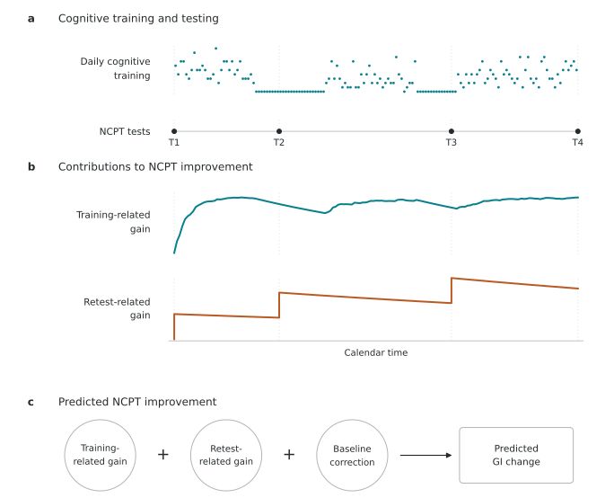
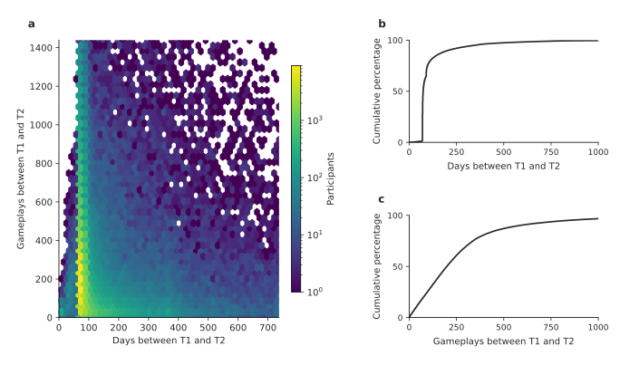
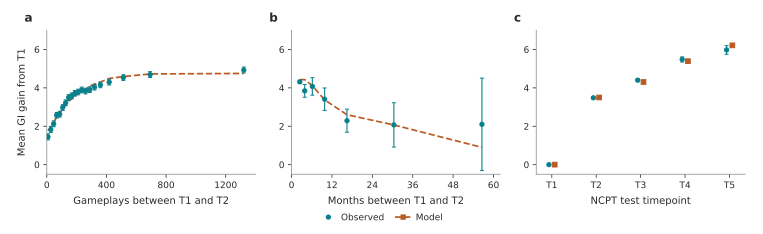
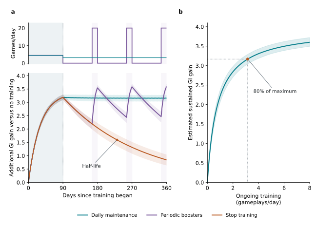

# Modeling the durability and maintenance of cognitive training gains in 172,731 adults

Medha Sharma1 and Robert John Schafer2,*

1 Birla Institute of Technology and Science, Pilani, K K Birla Goa Campus, Zuarinagar, Goa, India.

2 Lumos Labs, Inc., San Francisco, California, United States.

* Correspondence: Robert John Schafer, PhD, Lumos Labs, Inc., 16 Maiden Lane, Suite 600, San Francisco, CA 94108, United States. Email: bschafer@lumoslabs.com.

## Abstract

Sustaining gains from digital cognitive training requires understanding their durability and the training needed to maintain them. We analyzed 96.5 million cognitive training gameplays and 409,486 completions of a separate cognitive test battery from 172,731 adults using a widely available program. A learning-and-forgetting model separately represented training-related gains and retest improvements in the battery's overall composite score. In held-out participants, the model predicted improvement more accurately than a model based on cumulative training amount without accounting for elapsed time. The estimated training-related half-life after stopping training was 141 days (95% confidence interval 117–167). A maintenance dose of about three gameplays per day (approximately 10 minutes) was predicted to sustain 80% of the estimated maximum training-related gain. At equal total training amounts, simulations showed similar maintenance with daily or three-times-weekly training, while periodic boosters sustained gains with greater fluctuations. Findings from this large real-world dataset connect cognitive training schedules to durability and provide quantitative targets for prospective comparisons of maintenance and booster regimens.

## Introduction

Cognitive training uses structured, repeated cognitive activities to improve cognitive performance. Digital delivery supports widely accessible training programs and applications in digital health and digital medicine [1,2]. Improvements on untrained cognitive tests have been reported in meta-analyses of cognitive training in middle-aged and older adults [3,4,5,6] and in a large randomized trial enrolling adults aged 18–80 years [7], with effects varying across training approaches and outcomes.

For programs intended for ongoing use, the amount and timing of training needed to sustain improvement are central to intervention design. Gains on untrained tests are commonly explained through transfer of learning, in which learning acquired through training carries over to performance on tasks that were not trained [4]. Although transfer has been studied extensively, its time course remains less clear: how quickly gains develop, how they decay, and how these processes depend on the training schedule. Trials differ in session duration, weekly frequency, total training period, and subsequent training. ACTIVE provided ten 60–75-minute sessions over five to six weeks, with subsets of participants receiving four 75-minute booster sessions at 11 months and again at 35 months [8,9,10]. Corbett et al. recommended 10 minutes of daily online training over six months [11]. Experiments varying the spacing of a fixed amount of training have produced different results across populations and tasks [12,13,14].

Dose–response research has also examined training amount and frequency. Liu et al. linked daily training duration and weekly frequency to improvement in a composite derived from training-task performance in 8,709 adults with subjective cognitive decline, mild cognitive impairment, or mild dementia [15]. Designing maintenance regimens requires connecting these schedules to the accumulation and loss of gains over time. A model of learning and forgetting could estimate a maintenance dose—the ongoing training needed to sustain a specified level of improvement. Gains could be maintained through regular ongoing training or periodic booster courses separated by periods without training. For boosters, duration, frequency, and daily intensity together determine the amount of training and the time available for gains to decline between courses.

In this study, we used Lumosity, a widely available digital cognitive training program, because of its prior research characterization and large real-world dataset [7,16]. Its training tasks span multiple cognitive domains [16] and provided the basis for a prescription digital therapeutic cleared by the US Food and Drug Administration for adult ADHD [17].

In an observational study of 107,005 real-world Lumosity users, Osman et al. found that greater amounts of cognitive training were associated with greater improvement in the overall composite score from the NeuroCognitive Performance Test (NCPT), a battery of cognitive tests separate from the training tasks [18]. Their fitted curve showed diminishing additional gains with increasing training and separated two sources of improvement: the retest effect, estimated as the gain at zero intervening training, and transfer, the additional improvement associated with cognitive training. This analysis related improvement to cumulative training amount but did not account for when training occurred or how either component developed and decayed over time.

We analyzed 96.5 million cognitive training gameplays and 409,486 NCPT battery completions from 172,731 adults to estimate durability and maintenance during real-world use. The model described change in the overall NCPT composite score through separate training-related gains and retest improvements, with a correction for baseline performance relative to age. Daily gameplay histories and up to five NCPT testing timepoints per participant provided information about learning and forgetting across different amounts and timing of training. We tested whether the model predicted improvement in held-out participants more accurately than a model based on cumulative training without elapsed time. We then estimated durability after training stops and maintenance doses for specified gains, and compared continuous training with periodic boosters at the same total training amount.

## Methods

### Data and participants

The dataset included NCPT testing records and cognitive training gameplay records from Lumosity (Lumos Labs) for the same users. A gameplay was one recorded play of a cognitive training game. The NCPT is a web-based battery of cognitive tests with published reliability and validity data [19]. We used records from five NCPT batteries, with five to nine subtests per battery. These batteries have been described in the published NCPT dataset [20]. Battery composition and sample sizes are given in Supplementary Table 2.

During the study period, all subscribers were eligible to take the NCPT. Testing was optional and carried no incentive. Invitations were delivered through in-product messages and emails; prompts for repeat testing did not vary according to prior NCPT performance or cognitive training use. After a test, the NCPT was generally unavailable for 70 days to limit repeated practice. For a small subset of users, this restriction was temporarily shortened or removed to examine test–retest reliability and stability. Availability of these shorter retest intervals was not based on participant characteristics or performance. After testing, users could view raw scores on individual tests, and for a period of time could also view the standardized Grand Index (GI). No cognitive training recommendations were presented as part of NCPT testing.

Participants were eligible if they were aged 18–89 years at their first NCPT testing timepoint (T1), their preferred language was English, and their signup country was the United States, Canada, Australia, or New Zealand. To minimize the influence of cognitive training before the baseline test, eligible participants had completed no more than 25 gameplays before T1, consistent with Osman et al. [18]. Inclusion in the model also required at least two consecutive valid testing timepoints using the same NCPT battery and subtests.

Analysis was limited to each participant’s first five NCPT testing timepoints (T1–T5). Each testing session required valid results for every subtest, with no gap exceeding 24 hours between successive subtest results. Sessions whose subtest records overlapped another session were excluded. A missing or invalid session, or a change in battery or subtests, ended follow-up. Earlier eligible sessions were retained when at least T1 and T2 remained.

We counted cognitive training gameplays between successive NCPT testing sessions, using the earliest subtest-result timestamp as the start of each session. To exclude unusually high training rates, intervals were eligible if they contained no more than 20 gameplays per calendar day, counting both test dates: a maximum of 20 × (calendar-day difference + 1). At the first interval exceeding this limit, we excluded that interval and all subsequent testing timepoints.

We excluded testing sessions with a GI outside 40–160, corresponding to four normative standard deviations from 100. We also excluded changes between successive sessions more than four standard deviations from the observed mean change (acceptable range: −26.59 to 32.37 GI points), applying the same thresholds to all intervals through T5. Follow-up ended at the first testing session failing either score criterion. The final cohort contained 172,731 participants and 409,486 NCPT testing timepoints between March 2013 and June 2020. Supplementary Tables 1–3 describe participant characteristics, battery composition, and participant selection.

### Outcome measure

The modeled outcome was change from T1 in the overall composite measure from the NCPT battery, expressed as Grand Index (GI) points. We calculated battery-specific norms using the census-weighted method described by Jaffe et al. [20], combining standardized subtest scores into a composite with a reference mean of 100 and standard deviation of 15. Norms were derived from participants’ first NCPT tests and applied unchanged to subsequent testing timepoints. Reference-sample criteria and additional scoring details are provided in Supplementary Note 1.

### Model

The model described change in the overall NCPT composite score through three contributions (Fig. 1): improvement associated with cognitive training, G; learning retained from previous NCPT tests, R; and a baseline correction, B. Training-related and retest-related gains were zero at T1. At each follow-up, their sum and the baseline correction predicted change from T1:

$$
{\widehat{Y} }_{ij} = {G}_{ij} + {R}_{ij} + {B}_{i},  j \geq  2 \tag{1}
$$

Training-related improvement increased with each gameplay, with diminishing returns as it approached a maximum gain, A. The learning rate kL specified the fraction of the remaining possible improvement acquired per gameplay. For p gameplays in a calendar day, the learning fraction was ℓ(p) = 1 − (1 − kL) raised to p. Learning was followed by forgetting as the calendar date advanced. With training-related forgetting rate kG per day, the daily update was:

$$
{G}_{t+1} = [{G}_{t} + \ell ({p}_{t})(A - {G}_{t})](1 - {k}_{G}) \tag{2}
$$

We applied the model to observed daily gameplay counts between successive NCPT tests. Test-day gameplays were assigned to intervals according to their timestamps, using the earliest subtest-result timestamp as the testing boundary. Predicted scores included learning from games before the test. Forgetting depended on the number of calendar days between dates; days without training contributed forgetting alone. Supplementary Notes 2–3 describe the daily updates and numerical checks.

Each NCPT test provided an opportunity for learning that could affect later test performance. The input q(a) depended on age a at T1, in completed years. Its value at age 50 was q50, with β describing its proportional change per 20 years of age. Learning from a test was added after that test and diminished before the next test according to a separate retest forgetting rate kR. For an interval of D calendar days:

$$
q(a) = {q}_{50} \exp[\frac{\beta (a - 50)}{20}] \tag{3}
$$

$$
{R}_{out} = ({R}_{in} + q(a)){(1 - {k}_{R})}^{D} \tag{4}
$$

The baseline correction accounted for the association between initial performance and subsequent change. Within each fitting sample, we first estimated expected T1 GI as a quadratic function of age, using one baseline score per participant. This age-reference curve was then held fixed while fitting follow-up changes. The difference between a participant's T1 score and this age-specific expectation, expressed in units of 15 GI points, was multiplied by the baseline correction coefficient γ and added to predicted follow-up change:

$$
{B}_{i} = \gamma  \frac{{GI}_{i1} - \mu ({a}_{i})}{15} \tag{5}
$$

$$
\mu (a) = {c}_{0} + {c}_{1}t + {c}_{2}{t}^{2},  t = \frac{a - 50}{20} \tag{6}
$$

The baseline correction coefficient was estimated alongside the learning and forgetting parameters; the correction did not change the GI scores. Predicted change at T1 remained zero by definition.

We jointly fitted seven outcome coefficients: A, kL, kG, q50, β, kR, and γ. Three additional coefficients described the baseline age-reference curve. Durability was expressed as a separate half-life for training-related and retest-related learning, the time for half of the corresponding gain to be lost without another learning input:

$$
{h}_{G} = \frac{\log(0.5)}{\log(1 - {k}_{G})},   {h}_{R} = \frac{\log(0.5)}{\log(1 - {k}_{R})} \tag{7}
$$

### Statistical analyses

We minimized squared differences between predicted and observed GI changes. Squared errors were averaged across each participant's follow-up tests and then across participants, giving each person equal total weight regardless of the number of tests. We used L-BFGS-B optimization with analytic derivatives and multiple starting values. Learning and forgetting rates were bounded between 10⁻⁶ and 0.99, A between 0 and 30 GI points, q50 at zero or above, and β between −3 and 3. The linear baseline coefficient was unconstrained and estimated by least squares within each nonlinear optimizer evaluation. Implementation details are given in Supplementary Note 3.

Uncertainty was estimated from 500 bootstrap samples of participants, with replacement. Each sample retained a selected participant's complete testing and training history. The baseline age-reference curve and all seven outcome coefficients were re-estimated in every sample. Eligibility and score transformations were held fixed. We report the 2.5th and 97.5th percentiles as 95% confidence intervals (CIs), including for half-lives, maintenance doses, and illustrated training contrasts. All primary fits passed convergence checks, and none reached a parameter bound. Predictions, derivatives, and fitting losses were independently checked.

Prediction was evaluated using internal five-fold cross-validation. Each participant's complete history stayed within one fold, and both the baseline reference and outcome coefficients were estimated using only the other four folds. Root mean squared error (RMSE) used the same participant weighting as fitting. We compared observed and predicted means across training amounts, elapsed time, and testing timepoints. Error bars for observed means were ±1.96 standard errors. For comparison, simpler models predicted mean change, retest learning alone, learning without forgetting, or a saturating cumulative-training dose response without calendar time. All benchmarks used the same folds and an age-referenced baseline correction (Supplementary Note 5 and Table 4).

Supplementary analyses examined the association between training rate and improvement within participants (Supplementary Note 4) and evaluated alternative model specifications using the same participant bootstrap samples (Supplementary Note 5 and Table 4).

The analysis used a historical dataset, with no prospective sample-size calculation. All records meeting the criteria were included. Missing birth date excluded a participant; missing required test scores ended follow-up. Missing gender or education did not exclude participants from model estimation, although known education was required for the score-reference sample. Analyses used Python, NumPy, SciPy, pandas, and Matplotlib, with a compiled C objective. Versioned dependencies and seeds are recorded in the analysis package. Generative AI tools assisted code development and manuscript preparation; numerical outputs were checked against independent calculations.

### Durability and maintenance illustrations

We used an initial course of 400 gameplays over 90 days, distributed as four or five games per day, to illustrate improvement, durability, and maintenance. This represents approximately 20 cumulative hours, assuming about three minutes per gameplay for the approximate time equivalents reported throughout.

To examine the influence of timing at a fixed training amount, we compared this course with the same 400 gameplays distributed evenly over 730 days. We compared predicted total GI change from the learning-and-forgetting and cumulative-training models, with NCPT testing at the beginning and end of each period.

We also estimated the training-related GI advantage of the initial course relative to no cognitive training. Age, baseline GI, and NCPT testing history were identical in the two predictions, so their retest and baseline contributions canceled. We reported this contrast primarily in GI points and secondarily in units of the observed T1–T2 change-score SD, 7.219 points. This reference was calculated once across all participants and used for all standardized contrasts.

For daily maintenance, we calculated the training amount needed to sustain a specified training-related gain. With d gameplays per day, sustained improvement G* is the end-of-day gain when learning balances forgetting. We considered targets expressed both as a fraction f of the estimated maximum training-related gain A and as a fixed GI advantage.

$$
{G}^{*} = \frac{A(1 - {k}_{G})\ell (d)}{{k}_{G} + (1 - {k}_{G})\ell (d)},   \ell (d) = 1 - {(1 - {k}_{L})}^{d} \tag{8}
$$

$$
d(f) = \frac{\log[1 - \frac{{k}_{G}f}{(1 - {k}_{G})(1 - f)}]}{\log(1 - {k}_{L})} \tag{9}
$$

Following the initial course, we compared stopping training, daily maintenance, and periodic boosters through day 360. The two maintenance schedules each provided 840 gameplays over the next 270 days. Daily maintenance distributed these as three or four games per day, averaging 3.11. Boosters provided 20 games per day for the final 14 days of each 90-day cycle, following 76 days without training. We summarized predicted gains throughout follow-up and their mean across days 91–360, calculated from end-of-day values.

Additional simulations compared six maintenance schedules at the same total training amount over 360 days after the initial course (Supplementary Fig. 1 and Table 5). We evaluated all contrasts and schedules in each of the 500 participant bootstrap fits, calculating differences within each fit. Shaded bands show pointwise 95% confidence intervals for the mean predicted contrasts.

### Ethics

This research and release of deidentified data were covered by a WCG IRB exemption under 45 CFR § 46.104(d)(4). Participants received a research-use notice before each NCPT test and agreed electronically to proceed [18].

## Results

### Cognitive training and NCPT testing

The analysis included 172,731 participants who completed the NCPT at 409,486 testing timepoints and played 96.5 million cognitive training games between their first and last included tests. Participants completed the battery an average of 2.37 times; 125,863 (72.9%) completed it twice. Mean age at T1 was 52.9 years (SD 15.7), and 54.8% reported female gender. Baseline-eligible users who took only T1 were younger on average than users who returned for another test (46.0 versus 53.0 years). Supplementary Table 1 provides the full demographic breakdown and comparison of these groups.

The most common calendar-day gap between T1 and T2 was 70 days (25.3% of participants). The median was 74 days, and the 90th and 95th percentiles were 206 and 347 days. A total of 3,906 participants (2.3%) repeated the NCPT in fewer than 70 calendar days. Across all 236,755 intervals between successive tests, the mean and median calendar-day gaps were 175 and 90 days, and the longest was 2,558 days. The corresponding mean and median amounts of cognitive training were 407 and 228 gameplays. Figure 2 shows the variation in training amount and test timing.

Between T1 and T2, participants completed a median of 199 gameplays. Mean GI improvement increased from 1.75 points among those completing at most 50 games to 4.75 points among those completing at least 501 games, a difference of 3.00 points.

### Agreement between predicted and observed improvement

The model captured the increase in mean GI gain with cognitive training and the smaller gains observed over longer elapsed intervals (Fig. 3). Among participants with similar cumulative training, 300–500 games between T1 and T2, observed mean improvement was 4.31 points when the interval was 100 days or less and 2.29 points for intervals between one and two years. Corresponding held-out predictions were 4.43 and 2.60 points. Predicted mean gains also closely tracked observed gains across T2–T5 (Fig. 3c).

In a model illustration holding training amount constant at 400 evenly distributed gameplays, predicted total GI improvement, including retest learning, was 4.59 points over 90 days and 2.63 points over two years, a difference of 1.95 points (95% CI 1.85–2.07). The cumulative-training model predicted 4.44 points for either interval. These predictions used age 50, baseline performance equal to the expectation for age, and NCPT testing at the beginning and end of each interval.

In participant-level cross-validation, prediction error was lower for the learning-and-forgetting model than for the cumulative-training model without elapsed time (RMSE 6.89 versus 6.92 GI points), with lower error in all five folds. Additional benchmarks are reported with Supplementary Table 4. Greater training within the same participants was also associated with greater interval improvement (Supplementary Note 4).

### Parameter estimates and durability

Table 1 gives the parameter estimates. The estimated maximum training-related gain was 3.96 GI points (95% CI 3.84–4.10). For 400 gameplays over 90 days, the predicted training-related GI advantage over no training was 3.19 points (95% CI 3.09–3.29), equivalent to 0.44 observed change-score SDs (95% CI 0.43–0.46).

The training-related half-life was 141 days (95% CI 117–167), the time for half the acquired training-related gain to be lost after training stops. In the illustration, stopping after the initial 90 days reduced the additional GI gain from 3.19 points to 0.84 points by day 360 (Fig. 4a).

Retest learning persisted longer, with an estimated half-life of 1,341 days (95% CI 1,136–1,612). At age 50, the learning input from each NCPT test was 1.46 GI points before subsequent forgetting (95% CI 1.37–1.55). This input was 39.2% smaller for each additional 20 years of age (95% CI 37.6–40.9%). The corresponding point estimates were 2.40 at age 30 and 0.89 at age 70.

A baseline GI 15 points below the expected score for age was associated with 2.68 points more follow-up improvement, conditional on training and testing history (95% CI 2.63–2.72).

Selected model comparisons are reported in Supplementary Table 4.

### Table 1

| Parameter or equivalent measure | Estimate | 95% CI |
| --- | ---: | ---: |
| **General** | | |
| Baseline correction, γ (GI points per 15-point deviation) | −2.68 | −2.72 to −2.63 |
| **Training-related** | | |
| Maximum gain, A (GI points) | 3.96 | 3.84–4.10 |
| Learning rate, $k_L$ (per gameplay) | 0.00631 | 0.00572–0.00696 |
| Forgetting rate, $k_G$ (per day) | 0.00491 | 0.00413–0.00590 |
| &nbsp;&nbsp;*Equivalent half-life (days)* | 141 | 117–167 |
| **Retest-related** | | |
| Learning input at age 50, $q_{50}$ (GI points) | 1.46 | 1.37–1.55 |
| Age coefficient, β (per 20 years) | −0.497 | −0.526 to −0.471 |
| Forgetting rate, $k_R$ (per day) | 0.000517 | 0.000430–0.000610 |
| &nbsp;&nbsp;*Equivalent half-life (days)* | 1,341 | 1,136–1,612 |

**Table 1.** Model parameter estimates. The model estimates seven outcome coefficients. Each half-life expresses the corresponding forgetting rate in days. Confidence intervals are percentiles from 500 participant bootstrap fits. The three coefficients of the baseline age-reference curve were also re-estimated in every fit. Retest input is expressed before subsequent forgetting.

### Daily maintenance and periodic boosters

Continuing at approximately 3.1 gameplays per day after the initial 90-day course maintained the training-related gain at about 3.16 GI points through day 360 (Fig. 4a). The relationship between ongoing daily training and sustained improvement showed diminishing returns (Fig. 4b). One gameplay per day sustained 2.22 points (95% CI 2.06–2.38), and two per day sustained 2.84 points (95% CI 2.70–2.98).

For an illustrative maintenance target of 80% of the estimated maximum training-related gain, 3.17 GI points, the predicted dose was 3.2 gameplays per day (95% CI 2.7–3.7), roughly ten minutes under the approximate time conversion. Maintaining 90% required 7.2 gameplays per day (95% CI 6.1–8.5).

At the same total training amount, both daily maintenance and periodic boosters sustained gains through follow-up, with larger fluctuations under the booster regimen (Fig. 4a). By the third cycle, gains ranged from 2.47 immediately before the booster to 3.59 immediately afterward. Across days 91–360, the mean predicted gain was 2.91 points with boosters and 3.16 with daily maintenance, a difference of 0.25 points (95% CI 0.23–0.28).

In the extended schedule comparison, daily, weekdays-only, and three-times-weekly training produced nearly identical average gains, while the illustrated monthly, quarterly, and semiannual booster schedules produced progressively larger fluctuations and lower average gains (Supplementary Fig. 1 and Table 5).

## Discussion

This large real-world dataset connects the amount and daily timing of cognitive training to the durability and maintenance of gains on a separate cognitive test battery. Training-related gains had an estimated half-life of about five months, while learning associated with repeated NCPT testing persisted longer. A maintenance dose of about three gameplays per day, approximately ten minutes, was predicted to sustain 80% of the estimated maximum training-related gain. Both continuous training and periodic boosters sustained gains in simulations. These estimates provide quantitative targets for prospective comparisons of maintenance regimens. The gains examined here are improvements in cognitive-test performance; improvements in other types of outcomes were not measured.

The scale and daily detail of the dataset allowed us to extend earlier dose–response findings to describe how gains change over time. Osman et al. described the leveling off of NCPT improvement with greater cognitive training [18], while Liu et al. linked training duration and frequency to improvement on the training tasks themselves [15]. Here, daily gameplay histories distinguished periods of activity and inactivity. Accounting for their timing helped predict smaller improvements when similar amounts of training occurred over longer intervals, and improved prediction over the cumulative-training model in all five held-out folds. The within-person association between training rate and interval improvement also showed that the pattern extended beyond differences between consistently high-use and low-use participants.

Modeling training-related gains and retest learning separately helped characterize their different time courses. Retest learning was larger in younger adults, consistent with Osman et al. [18] and evidence that repeated-test gains vary with age and test interval [21,22]. Ng et al. found no detectable age-group difference in the training advantage over crossword practice in the program's randomized trial [23]. Our model allowed age to affect retest learning while assuming a common training response across ages. The longer persistence of retest learning suggests that repeated testing can contribute to the durability of observed score gains. Baseline performance was another substantial influence: lower initial GI relative to the expectation for age predicted greater improvement, a pattern that can reflect both regression to the mean and genuine differences in subsequent change.

Prior studies show considerable variation in durability across programs and outcomes. In IMPACT, several benefits persisted after three months without contact, although effects were generally smaller and the primary-outcome advantage was no longer statistically significant [24]. ACTIVE found reasoning and processing-speed benefits still detectable at ten years [9,10], and linked processing-speed training and boosters to gains maintained over five years [25]. The broader skill-retention literature also relates loss during nonuse to the skill, training, and retention interval [26]. Modeling the course of gains complements these follow-up comparisons by describing how improvement changes between testing timepoints and with continued training.

These findings support thinking of cognitive training as an ongoing activity with periods of acquisition, maintenance, and reduced use. Physical exercise offers a useful parallel: continued activity can maintain adaptations after an initial training period [27], while endurance and strength adaptations differ in their persistence during interruptions [28,29]. Fitness–fatigue models similarly describe the accumulation and decay of training effects [30]. Intermittent digital treatment has also been examined clinically. In an open-label pediatric ADHD study, improvements in clinical ratings persisted during a four-week pause, followed by further improvement during a second treatment period [31]. An ongoing-use framework brings maintenance and recovery after pauses into the design of cognitive interventions.

Half-life describes how quickly acquired gains decline after training stops. Maintenance training offsets those losses through frequent smaller amounts of training or intermittent booster courses. The maintenance dose quantifies the training needed for a chosen level of improvement. The maintenance curve showed diminishing returns, with progressively more training needed for gains near the estimated maximum. This approach provides a way to compare the training required for different targets and to select regimens that balance sustained gains with the time participants devote to training.

The similar modeled gains under daily, weekdays-only, and three-times-weekly schedules support flexibility in distributing training within the week. Comparing average gains, performance at selected follow-ups, and fluctuations between training periods also helps evaluate periodic boosters. ACTIVE used four-session booster courses at widely separated follow-ups [9,10,25]. In our simulations, periodic boosters sustained gains, with greater fluctuations and lower averages as the illustrated training-free gaps lengthened. Monthly and semiannual schedules devoted similar proportions of days to training but produced different trajectories, illustrating the importance of the absolute gap between courses. Booster duration, spacing, and intensity could be chosen to target either an average gain or a minimum between courses.

The observational design leaves several sources of uncertainty. The program's randomized, active-controlled trial provides evidence for an advantage over crossword practice [7], but motivation, effort, and health could influence both training and outcomes during voluntary use. An experiment manipulating recruitment expectations also demonstrated the potential for placebo effects in cognitive-training studies [32]. The within-person comparison addresses stable individual differences; changing circumstances and selective return for testing remain relevant. Repeat testers were older than T1-only users, and quality-related exclusions could introduce further selection. The training-related component may combine transfer with changes in engagement, expectations, and familiarity with digital tasks. Reviews reporting limited far transfer to general abilities also emphasize the importance of outcome choice [33,34,35]. Our sample comprised self-selected, English-speaking adults from four countries, many with higher education, using one program during 2013–2020.

Across the primary model and supplementary alternatives, training-related gains took approximately four to six months to fall by half after training stopped (Supplementary Table 4). This consistent timescale supports examining continued training and periodic boosters as ways to sustain gains. Differences emerged in retest forgetting, longer-term retention, and the maintenance dose required for a given target. Exponential forgetting assumes a constant half-life, whereas alternative retention functions allow loss to slow over time [36].

The scale and temporal detail of these real-world records provide a basis for designing maintenance studies around explicit durability estimates. A prospective comparison could assign continuous training or periodic boosters after a common initial course, include planned pauses and resumed use, and vary cognitive-test exposure independently. Measuring sustained cognitive performance, everyday function, and engagement would test the predicted course of gains alongside the feasibility of each regimen. Such studies could guide ongoing use of cognitive training in digital health and digital medicine.

## Data availability

Analysis-ready, deidentified data for the model cohort, aggregate statistics for the supplementary descriptive tables, and a data dictionary have been deposited in a private Zenodo draft (reserved DOI: [10.5281/zenodo.23901782](https://doi.org/10.5281/zenodo.23901782)). Access for peer review is available through a private link; public release is planned upon publication.

## Code availability

Analysis code, dependency versions, and instructions for reproducing the main and supplementary results are deposited in the same private Zenodo draft (reserved DOI: [10.5281/zenodo.23901782](https://doi.org/10.5281/zenodo.23901782)). The code is available through the private review link, with public release planned upon publication.

## Author contributions

M.S. and R.J.S. conceived and designed the study, developed the methodology, curated the data, developed the analysis software, performed the statistical analyses, validated and interpreted the results, prepared the figures and tables, and drafted and revised the manuscript. R.J.S. provided research resources, supervised the work, and administered the project.

## Acknowledgements

We thank the Lumos Labs research team for their support and scientific discussions.

Lumos Labs, Inc. supported this work through provision of the study data and research resources. R.J.S., an employee of Lumos Labs, contributed to study design, data preparation, analysis, interpretation, and manuscript preparation.

## Competing interests

R.J.S. is employed by Lumos Labs and holds equity in the company. M.S. has a parent who is employed by Lumos Labs.

## References

[1] Zang, G. Y., Rao, K., Wu, J., He, Y., Tang, Y. & Shi, L. Digital therapeutics for cognitive impairment: exploring innovations, challenges, and future prospects. J. Med. Internet Res. 27, e73689 (2025). https://doi.org/10.2196/73689

[2] Jeong, H. S., Lee, Y. W., Rhee, T. G. & Shim, S. R. Efficacy of digital therapeutic applications for cognitive training among older adults with mild cognitive impairment or dementia: a systematic review and network meta-analysis of randomized controlled trials. Psychiatry Res. 348, 116426 (2025). https://doi.org/10.1016/j.psychres.2025.116426

[3] Zhu, C., Arunogiri, S., Li, Q., Thomas, E. H. X. & Gurvich, C. Cognitive training during midlife: a systematic review and meta-analysis. Neuropsychol. Rev. 35, 427–448 (2025). https://doi.org/10.1007/s11065-024-09649-z

[4] Lampit, A., Hallock, H. & Valenzuela, M. Computerized cognitive training in cognitively healthy older adults: a systematic review and meta-analysis of effect modifiers. PLoS Med. 11, e1001756 (2014). https://doi.org/10.1371/journal.pmed.1001756

[5] Bonnechère, B., Langley, C. & Sahakian, B. J. The use of commercial computerised cognitive games in older adults: a meta-analysis. Sci. Rep. 10, 15276 (2020). https://doi.org/10.1038/s41598-020-72281-3

[6] Basak, C., Qin, S. & O’Connell, M. A. Differential effects of cognitive training modules in healthy aging and mild cognitive impairment: a comprehensive meta-analysis of randomized controlled trials. Psychol. Aging 35, 220–249 (2020). https://doi.org/10.1037/pag0000442

[7] Hardy, J. L. et al. Enhancing cognitive abilities with comprehensive training: a large, online, randomized, active-controlled trial. PLoS One 10, e0134467 (2015). https://doi.org/10.1371/journal.pone.0134467

[8] Ball, K. et al. Effects of cognitive training interventions with older adults: a randomized controlled trial. JAMA 288, 2271–2281 (2002). https://doi.org/10.1001/jama.288.18.2271

[9] Willis, S. L. et al. Long-term effects of cognitive training on everyday functional outcomes in older adults. JAMA 296, 2805–2814 (2006). https://doi.org/10.1001/jama.296.23.2805

[10] Rebok, G. W. et al. Ten-year effects of the ACTIVE cognitive training trial on cognition and everyday functioning in older adults. J. Am. Geriatr. Soc. 62, 16–24 (2014). https://doi.org/10.1111/jgs.12607

[11] Corbett, A. et al. The effect of an online cognitive training package in healthy older adults: an online randomized controlled trial. J. Am. Med. Dir. Assoc. 16, 990–997 (2015). https://doi.org/10.1016/j.jamda.2015.06.014

[12] Wang, Z. et al. Spaced cognitive training promotes training transfer. Front. Hum. Neurosci. 8, 217 (2014). https://doi.org/10.3389/fnhum.2014.00217

[13] Jaeggi, S. M. et al. Investigating the effects of spacing on working memory training outcome: a randomized, controlled, multisite trial in older adults. J. Gerontol. B Psychol. Sci. Soc. Sci. 75, 1181–1192 (2020). https://doi.org/10.1093/geronb/gbz090

[14] Booth, S. J. et al. Experimental investigation of training schedule on home-based working memory training in healthy older adults. Front. Psychol. 14, 1165275 (2023). https://doi.org/10.3389/fpsyg.2023.1165275

[15] Liu, L. et al. Dose–response relationship between computerized cognitive training and cognitive improvement. npj Digit. Med. 7, 214 (2024). https://doi.org/10.1038/s41746-024-01210-9

[16] Steyvers, M. & Schafer, R. J. Inferring latent learning factors in large-scale cognitive training data. Nat. Hum. Behav. 4, 1145–1155 (2020). https://doi.org/10.1038/s41562-020-00935-3

[17] Lumos Labs Medical. Prismira: 510(k) Summary, K243729. (2025). https://www.accessdata.fda.gov/cdrh_docs/pdf24/K243729.pdf

[18] Osman, A. M., Jaffe, P. I., Ng, N. F., Kerlan, K. R. & Schafer, R. J. Transfer of learning: analysis of dose-response functions from a large-scale, online, cognitive training dataset. PLoS One 18, e0281095 (2023). https://doi.org/10.1371/journal.pone.0281095

[19] Morrison, G. E., Simone, C. M., Ng, N. F. & Hardy, J. L. Reliability and validity of the NeuroCognitive Performance Test, a web-based neuropsychological assessment. Front. Psychol. 6, 1652 (2015). https://doi.org/10.3389/fpsyg.2015.01652

[20] Jaffe, P. I., Kaluszka, A., Ng, N. F. & Schafer, R. J. A massive dataset of the NeuroCognitive Performance Test, a web-based cognitive assessment. Sci. Data 9, 758 (2022). https://doi.org/10.1038/s41597-022-01872-8

[21] Calamia, M., Markon, K. & Tranel, D. Scoring higher the second time around: meta-analyses of practice effects in neuropsychological assessment. Clin. Neuropsychol. 26, 543–570 (2012). https://doi.org/10.1080/13854046.2012.680913

[22] Salthouse, T. A. Influence of age on practice effects in longitudinal neurocognitive change. Neuropsychology 24, 563–572 (2010). https://doi.org/10.1037/a0019026

[23] Ng, N. F., Osman, A. M., Kerlan, K. R., Doraiswamy, P. M. & Schafer, R. J. Computerized cognitive training by healthy older and younger adults: age comparisons of overall efficacy and selective effects on cognition. Front. Neurol. 11, 564317 (2021). https://doi.org/10.3389/fneur.2020.564317

[24] Zelinski, E. M. et al. Improvement in memory with plasticity-based adaptive cognitive training: results of the 3-month follow-up. J. Am. Geriatr. Soc. 59, 258–265 (2011). https://doi.org/10.1111/j.1532-5415.2010.03277.x

[25] Ball, K. K., Ross, L. A., Roth, D. L. & Edwards, J. D. Speed of processing training in the ACTIVE study: how much is needed and who benefits? J. Aging Health 25, 65S–84S (2013). https://doi.org/10.1177/0898264312470167

[26] Arthur, W. Jr, Bennett, W. Jr, Stanush, P. L. & McNelly, T. L. Factors that influence skill decay and retention: a quantitative review and analysis. Hum. Perform. 11, 57–101 (1998). https://doi.org/10.1207/s15327043hup1101_3

[27] Hickson, R. C. & Rosenkoetter, M. A. Reduced training frequencies and maintenance of increased aerobic power. Med. Sci. Sports Exerc. 13, 13–16 (1981). https://pubmed.ncbi.nlm.nih.gov/7219129/

[28] Coyle, E. F., Martin, W. H. III, Sinacore, D. R., Joyner, M. J., Hagberg, J. M. & Holloszy, J. O. Time course of loss of adaptations after stopping prolonged intense endurance training. J. Appl. Physiol. 57, 1857–1864 (1984). https://doi.org/10.1152/jappl.1984.57.6.1857

[29] Bickel, C. S., Cross, J. M. & Bamman, M. M. Exercise dosing to retain resistance training adaptations in young and older adults. Med. Sci. Sports Exerc. 43, 1177–1187 (2011). https://doi.org/10.1249/MSS.0b013e318207c15d

[30] Morton, R. H., Fitz-Clarke, J. R. & Banister, E. W. Modeling human performance in running. J. Appl. Physiol. 69, 1171–1177 (1990). https://doi.org/10.1152/jappl.1990.69.3.1171

[31] Kollins, S. H., Childress, A., Heusser, A. C. & Lutz, J. Effectiveness of a digital therapeutic as adjunct to treatment with medication in pediatric ADHD. npj Digit. Med. 4, 58 (2021). https://doi.org/10.1038/s41746-021-00429-0

[32] Foroughi, C. K., Monfort, S. S., Paczynski, M., McKnight, P. E. & Greenwood, P. M. Placebo effects in cognitive training. Proc. Natl Acad. Sci. USA 113, 7470–7474 (2016). https://doi.org/10.1073/pnas.1601243113

[33] Simons, D. J. et al. Do “brain-training” programs work? Psychol. Sci. Public Interest 17, 103–186 (2016). https://doi.org/10.1177/1529100616661983

[34] Melby-Lervåg, M., Redick, T. S. & Hulme, C. Working memory training does not improve performance on measures of intelligence or other measures of “far transfer”: evidence from a meta-analytic review. Perspect. Psychol. Sci. 11, 512–534 (2016). https://doi.org/10.1177/1745691616635612

[35] Sala, G. & Gobet, F. Cognitive training does not enhance general cognition. Trends Cogn. Sci. 23, 9–20 (2019). https://doi.org/10.1016/j.tics.2018.10.004

[36] Wixted, J. T. & Ebbesen, E. B. On the form of forgetting. Psychol. Sci. 2, 409–415 (1991). https://doi.org/10.1111/j.1467-9280.1991.tb00175.x

## Figure 1

**Figure 1.** Conceptual model of improvement on the NCPT. **a,** Daily cognitive training and periodic NCPT tests shown on a common calendar-time axis. Each small dot represents one day’s gameplay count; test intervals vary. **b,** Corresponding training-related and retest-related contributions to NCPT improvement. Training-related gains build during training and diminish during pauses. Each NCPT test contributes learning to subsequent test performance, with an age-dependent input and a separately estimated forgetting rate. The retest curve shows learning immediately after each test and its retention until the next test; a test’s own score precedes its new learning input. Dotted guides align the test timepoints across rows. **c,** Training-related gain, retest-related gain, and a correction for initial GI relative to age are added to predict change from T1 in the overall NCPT composite at each follow-up. Schedules and curves are qualitative illustrations, with arbitrary vertical scales.

## Figure 2

**Figure 2.** Cognitive training and NCPT test timing for 172,731 participants. **a,** Joint distribution of calendar days and gameplays between T1 and T2. Color shows participant counts on a logarithmic scale; displayed axes end at their respective 99th percentiles. **b,** Cumulative distribution of calendar days between T1 and T2. **c,** Cumulative distribution of gameplays between T1 and T2. Both cumulative distributions include all participants and are displayed to 1,000 on their respective horizontal axes.

## Figure 3

**Figure 3.** Observed and predicted improvement in the overall NCPT composite (GI). **a,** Mean T1–T2 gains in 20 approximately equal-sized gameplay groups, plotted at mean gameplay counts. All 172,731 participants are represented. **b,** Gains against mean elapsed months among participants with similar cumulative training: 30,587 participants with 300–500 gameplays between T1 and T2. Bins are 0–100, >100–150, >150–240, >240–365, >365–730, >730–1,460, and >1,460 days; all eligible intervals are included. The longest-interval group contains 36 participants. **c,** Mean gains at T1–T5, with 172,731, 172,731, 46,868, 12,466, and 4,690 participants, respectively. T1 is zero change by definition; later timepoints contain different subsets. Circles and error bars show observed means and approximate 95% confidence intervals. Dashed lines in a and b and squares in c show model predictions, held out by participant and averaged over the same people as the observed means. The model uses participants’ actual daily gameplay histories, test timing, ages, and baseline scores.

## Figure 4

**Figure 4.** Model illustrations of durability and maintenance. a, Daily training schedules (upper plot) and additional GI gain relative to no training (lower plot). All schedules start with 400 gameplays over 90 days. Daily maintenance and boosters each add 840 games over the next 270 days: an average of 3.11 games/day, or 20 daily games for 14 days at the end of each 90-day cycle. The upper plot shows average daily rates within each training phase; gain curves use the corresponding integer-day schedules. The third schedule stops after day 90. Comparisons share age, baseline GI, and testing history, so retest and baseline terms cancel. The marker indicates half the acquired gain remaining 141 days after stopping. b, Sustained training-related gain under constant daily training. The marked dose sustains 80% of the estimated maximum gain, 3.17 GI points, at approximately 3.2 games/day (95% CI 2.7–3.7). Shading shows pointwise 95% participant-bootstrap intervals. Assuming about three minutes per game, daily maintenance is roughly ten minutes/day and boosters about an hour per active day.
