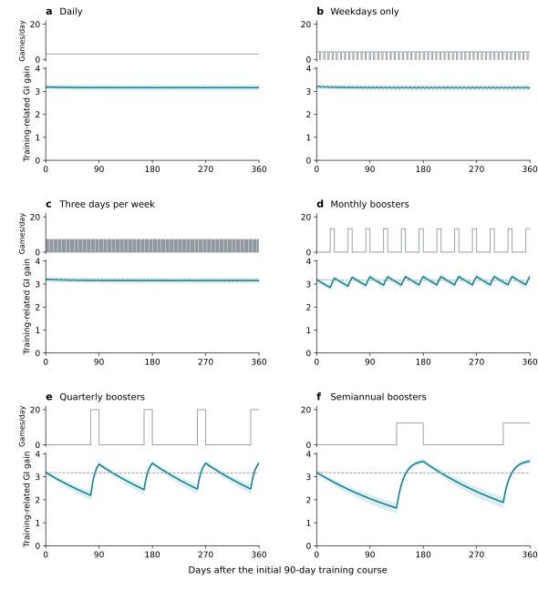

# Supplementary information

**Modeling the durability and maintenance of cognitive training gains in 172,731 adults**

Medha Sharma and Robert John Schafer

NCPT denotes the NeuroCognitive Performance Test, a battery of cognitive tests. The Grand Index (GI) is its overall composite score. T1–T5 denote successive NCPT testing timepoints; each battery completion contributes one GI. A gameplay is one recorded play of a cognitive training game.

## Contents

<!-- BEGIN CONTENTS -->
- [Participants and cognitive scores](#participants-and-cognitive-scores)
  - [Table 1. Participant characteristics](#supplementary-table-1)
  - [Table 2. Battery composition and sample sizes](#supplementary-table-2)
  - [Note 1. Score construction and quality criteria](#supplementary-note-1-score-construction-and-quality-criteria)
  - [Table 3. Participant selection](#supplementary-table-3)
- [Model implementation and estimation](#model-implementation-and-estimation)
  - [Note 2. Daily cognitive training and calendar time](#supplementary-note-2-daily-cognitive-training-and-calendar-time)
  - [Note 3. Fitting and numerical verification](#supplementary-note-3-fitting-and-numerical-verification)
- [Additional analyses](#additional-analyses)
  - [Note 4. Baseline associations and within-person analysis](#supplementary-note-4-baseline-associations-and-within-person-analysis)
  - [Note 5. Predictive benchmarks and selected specification comparisons](#supplementary-note-5-predictive-benchmarks-and-selected-specification-comparisons)
  - [Table 4. Model comparisons](#supplementary-table-4)
- [Durability and maintenance](#durability-and-maintenance)
  - [Note 6. Cognitive-training contrasts and standardization](#supplementary-note-6-cognitive-training-contrasts-and-standardization)
  - [Note 7. Maintenance doses and training-regimen simulations](#supplementary-note-7-maintenance-doses-and-training-regimen-simulations)
  - [Figure 1. Maintenance schedules and predicted gains](#supplementary-figure-1)
  - [Table 5. Maintenance-schedule comparison](#supplementary-table-5)
<!-- END CONTENTS -->

## Participants and cognitive scores

### Supplementary Table 1

Participant characteristics among baseline-eligible users who completed only T1, those who returned for testing, and the final model cohort.

| Characteristic | T1 only | Returned for testing | Model cohort |
| --- | --- | --- | --- |
| Participants, n | 183,320 | 207,918 | 172,731 |
| Age at T1, mean (SD), years | 45.98 (17.05) | 53.04 (15.82) | 52.85 (15.73) |
| GI at T1, mean (SD) | 101.71 (14.46) | 99.56 (14.25) | 100.08 (14.07) |
| Age-referenced baseline GI, mean (SD) | -1.71 (11.79) | -0.40 (11.40) | 0.00 (11.28) |
| Gameplays before T1, median [IQR] | 14.0 [9.0, 18.0] | 15.0 [11.0, 18.0] | 15.0 [11.0, 18.0] |
| Days from signup to T1, median [IQR] | 7.7 [2.8, 127.1] | 7.2 [3.1, 91.1] | 7.1 [3.0, 82.5] |
| Female, n (%) | 89,216 (48.7%) | 114,566 (55.1%) | 94,641 (54.8%) |
| Male, n (%) | 75,078 (41.0%) | 74,494 (35.8%) | 62,343 (36.1%) |
| Gender not reported, n (%) | 19,026 (10.4%) | 18,858 (9.1%) | 15,747 (9.1%) |
| High school or less, n (%) | 21,414 (11.7%) | 20,906 (10.1%) | 17,123 (9.9%) |
| Some college or undergraduate degree, n (%) | 98,451 (53.7%) | 110,027 (52.9%) | 91,340 (52.9%) |
| Professional or graduate education, n (%) | 40,261 (22.0%) | 53,891 (25.9%) | 45,043 (26.1%) |
| Other education, n (%) | 3,245 (1.8%) | 3,545 (1.7%) | 2,847 (1.6%) |
| Education not reported, n (%) | 19,949 (10.9%) | 19,549 (9.4%) | 16,378 (9.5%) |

The table includes 391,238 users with a valid first NCPT test who met the baseline eligibility criteria. Returned for testing includes users with any subsequent recorded NCPT test, including tests later excluded from the model. The final model cohort is a subset of those who returned. The age-reference curve is estimated in the model cohort and applied to each comparison group. Values are counts (%), means (SD), or medians [interquartile range], as labeled.

### Supplementary Table 2

Battery composition and sample sizes. Reference participants supplied the distributions used to construct GI scores; model participants completed an eligible NCPT battery at least twice.

| Battery ID | Subtests | Reference participants, n | Model participants, n | NCPT battery completions |
| --- | --- | ---: | ---: | ---: |
| 17 | Divided visual attention; Forward memory span (v1); Arithmetic reasoning; Grammatical reasoning; Progressive matrices; Go/no-go (v2) | 37,394 | 19,544 | 45,933 |
| 32 | Divided visual attention; Forward memory span (v1); Arithmetic reasoning; Grammatical reasoning; Progressive matrices; Reverse memory span (v1); Digit symbol coding (v1); Trail making part A; Trail making part B | 51,992 | 27,461 | 62,285 |
| 39 | Forward memory span (v1); Arithmetic reasoning; Grammatical reasoning; Progressive matrices; Reverse memory span (v1); Digit symbol coding (v1); Trail making part A; Trail making part B | 103,610 | 59,304 | 136,202 |
| 50 | Arithmetic reasoning; Grammatical reasoning; Progressive matrices; Trail making part A; Trail making part B; Forward memory span (v2); Reverse memory span (v2); Digit symbol coding (v2) | 148,583 | 65,245 | 161,870 |
| 60 | Scale balance; Posner cueing; Complex memory span; Object recognition; Dual search | 3,390 | 1,177 | 3,196 |
| Total | | 344,969 | 172,731 | 409,486 |

Subtest names and version labels follow Jaffe et al. [reference 20 in the main text]. Versions distinguish the earlier and later forward memory span, reverse memory span, and digit symbol coding tasks; the Go/no-go task in battery 17 is version 2. Complex memory span is referred to as Complex Span in Supplementary Note 1. Each modeled participant completed the same battery and subtest versions throughout follow-up.

### Supplementary Note 1. Score construction and quality criteria

The reference distribution for each battery included first-ever NCPT tests from eligible adults with known education and no more than 25 prior gameplays. Participants with missing education or education recorded as “other” could receive a GI using the established score conversions but did not contribute to their estimation. Each battery's reference sample contained at least 1,000 participants and represented all 18 age-by-education groups; the smallest group contained 31 participants. The five reference samples contained 344,969 participants in total.

The reference groups combined six age ranges, 18–29, 30–39, 40–49, 50–59, 60–69, and 70–89 years, with three educational groups: high school or less; some college, associate’s degree, or college degree; and professional or graduate education. Census weights matched the joint age-by-education distribution of the 2019 US American Community Survey, restricted to ages 18–89.

Raw scores were converted to census-weighted percentiles, assigning tied scores the same percentile, and then to standardized scores with mean 100 and SD 15. The mean across subtests was standardized again to obtain the GI. Score conversions were estimated from first tests and applied unchanged to follow-up tests. GI scores used a common census-weighted adult reference distribution.

Complex Span used the greatest mixed letter–digit sequence length with correct recall and arithmetic on the same trial. A valid record with no successful trial received a score of zero. Incomplete or malformed logs and inconsistent sequence progression were excluded.

The older Digit Symbol task (subtest 38) could finish before 90 seconds when all items had been presented. We retained tests lasting 89–90 seconds, or tests with 66–69 responses completed in 20–90 seconds. Correct-response counts had to be valid and nonnegative; early completions also required valid, nonnegative error counts. Total responses were correct responses plus errors. Scores were calculated as correct responses per second multiplied by 90. The newer fixed-duration Digit Symbol task (subtest 45) retained its correct-response count. The same scoring and completion rules were applied to the reference and longitudinal samples.

Timed reaction and trail-making measures were scored so that higher values indicated better performance before standardization. Recorded times had to be positive, and trail-making times could not exceed 15 minutes. Other count scores had to be nonnegative. Complete batteries required scores for every subtest, with no gap between successive subtest results longer than 24 hours. Interleaved testing sessions were excluded.

We excluded GI scores outside 40–160 and consecutive GI changes outside −26.59 to 32.37 points. These change limits were four SDs from the mean in eligible T1–T2 and T2–T3 intervals before completion and score exclusions (mean 2.89, SD 7.37). The same limits were applied through T5.

### Supplementary Table 3

Participant selection from the baseline-eligible sample. Exclusions are applied sequentially and are mutually exclusive at the second test.

| Stage | Excluded n | Remaining n |
| --- | --- | --- |
| Baseline-eligible sample | 0 | 391,238 |
| No subsequent recorded NCPT test | 183,320 | 207,918 |
| Different battery at the second test | 4,324 | 203,594 |
| Required subtests missing at the second test | 18,566 | 185,028 |
| No valid second-test GI despite the required subtests being present | 9,244 | 175,784 |
| First interval exceeded 20 gameplays per (calendar-day difference + 1) | 2,835 | 172,949 |
| Second-test GI or first-interval GI change outside the fixed four-SD bounds | 218 | 172,731 |
| Final model cohort | 0 | 172,731 |

Baseline eligibility already incorporates account, population, prior-training, complete-battery, and valid-T1-score requirements. This table therefore starts with users who have an eligible baseline rather than all subscribers. The final cohort contributes 409,486 NCPT battery completions and 236,755 follow-up intervals, with 96,461,780 intervening gameplays.

## Model implementation and estimation

### Supplementary Note 2. Daily cognitive training and calendar time

Daily gameplay records accounted for all 96,461,780 gameplays across the 236,755 periods between included NCPT tests. We used the timestamp of the first recorded subtest result to separate games played before and after each test, then grouped gameplays by calendar date. Retest learning from a test affected subsequent scores.

For p observed gameplays on a date, the training-related gain after learning was:

$$
G_{+} = A - (A - G_{in})(1 - k_L)^p \tag{S1}
$$

The gain retained after advancing D calendar days to the next training or testing event was:

$$
G_{out} = G_{+}(1 - k_G)^D \tag{S2}
$$

The update was applied chronologically. On a testing date, games before the test contributed to that score; games after the test contributed to subsequent scores. Events on the same date had D = 0. Dates without gameplay contributed forgetting alone. Retest forgetting used the calendar-date difference between successive tests. Simulated training days applied learning followed by one day of forgetting, and regimen summaries used these end-of-day gains.

### Supplementary Note 3. Fitting and numerical verification

The baseline correction coefficient γ was estimated by weighted least squares during fitting of the learning and forgetting parameters. The quadratic baseline-age curve was estimated from T1 scores, with one observation per participant and the fitting sample’s participant weights. It was re-estimated in each cross-validation training sample and bootstrap resample.

Models were fitted using L-BFGS-B optimization with analytic derivatives. Full-sample and cross-validation fits used multiple starting values. Bootstrap fits started from the full-sample estimate, with additional starts for supplementary comparisons and when convergence checks failed. Fits that did not meet convergence criteria were rerun with stricter settings or additional starting values. We retained the converged fit with the lowest weighted prediction error; no bootstrap sample was discarded.

Independent calculations verified model predictions, derivatives, and maintenance estimates. Checks also confirmed correct handling of same-day games and tests and that held-out outcomes did not influence predictions. Full numerical settings and verification results are provided in the analysis package.

Internal cross-validation used five participant folds. The comparisons formed part of the exploratory model-development process. Squared prediction errors were averaged within each participant and then across participants, giving a person with five tests the same total weight as a person with two. Each bootstrap sample included participants’ complete histories, with their contribution weighted by how often they were sampled. Eligibility and score conversions were held fixed.

## Additional analyses

### Supplementary Note 4. Baseline associations and within-person analysis

Across model participants, baseline GI was weakly associated with T1–T2 gameplay count (r = −0.015) and more strongly associated with T1–T2 GI change (r = −0.180).

The within-person analysis used 110,892 consecutive test intervals from 46,868 participants with T3 or later. The outcome was the GI change within an interval. Training intensity was log[1 + gameplays/(calendar-day difference + 1)]. A participant fixed effect removed stable differences in mean interval gain. Covariates included indicators for testing timepoint, log(1 + calendar-day difference) and its square, log(1 + prior cumulative gameplays), and interactions of testing timepoint with age and baseline GI. Each participant had total weight one. Standard errors accounted for repeated intervals within participants, including the test shared by adjacent intervals.

After adjustment for these covariates, a within-person increase from one to three games per inclusive calendar day was associated with 0.74 points more interval improvement (95% CI 0.62–0.85).

### Supplementary Note 5. Predictive benchmarks and selected specification comparisons

All benchmarks used the same cohort, five participant folds and equal participant weighting as the primary model. The baseline age-reference curve and outcome coefficients were estimated within the training folds. The mean model estimates one average follow-up change; the retest-only model includes age-dependent learning from tests and retest forgetting; the no-forgetting model sets both forgetting rates to zero. The cumulative-training model combines a saturating cumulative-gameplay curve with separate age-dependent intercepts at T2–T5 and contains no calendar-time term. Each benchmark estimates its own baseline correction.

The retest comparison uses Rout = [(1 − α)Rin + q(a)] × (1 − kR)^D, with α bounded between zero and 0.99. Setting α = 0 recovers the primary model exactly. Positive values allow the additional gain from a test to decrease as retained retest learning accumulates. All other coefficients, including the baseline reference and correction, are refitted.

The longitudinal-change comparison adds d50T + dage[(a − 50)T/20 + T²/40], where T is elapsed years since T1. This represents an annual change rate that varies linearly with age during follow-up. The two coefficients are estimated from longitudinal outcomes. Their addition produced little improvement in overall prediction and moved retest forgetting to its lower bound.

The slowing-decay alternative uses retention 1/(1 + λt) after a single learning input, with λ = −log(1 − kG). It represents training-related learning as a mixture of components that receive the same gameplay input but forget at different rates. The slower-forgetting components contribute more to retention as time passes. Retest dynamics and the baseline correction are unchanged. The model was evaluated by numerical integration, with accuracy checked using higher-resolution calculations. Bootstrap half-retention times were calculated after 400 gameplays over 90 days followed by cessation.

### Supplementary Table 4

The primary model had lower held-out prediction error than each simpler benchmark in all five folds. Overall RMSE was 6.8907 GI points for the primary model, compared with 7.0324 for mean follow-up change, 6.9726 for retest learning alone, 6.9196 for learning without forgetting, and 6.9169 for cumulative training without elapsed time.

The table compares durability, maintenance, and prediction error across the primary model and alternatives allowing retest saturation, longitudinal age-related change, or slowing decay. All models used the same cohort, participant weighting, validation folds, and age-referenced baseline correction. RMSE denotes root mean squared prediction error.

| Quantity | Primary | Retest saturation | Age-related change | Slowing decay |
| --- | --- | --- | --- | --- |
| Training half-life or half-retention time, days | 140.8 (117.1–167.4) | 140.8 (117.1–167.4) | 174.7 (140.3–214.1) | 148.1 (125.3–174.7) |
| Retest half-life, days | 1341.3 (1135.9–1612.3) | 1341.3 (1135.9–1612.3) | At near-zero decay bound | 1062.0 (915.6–1257.3) |
| Maintenance dose for 80% of maximum gain, gameplays/day | 3.15 (2.70–3.73) | 3.15 (2.70–3.73) | 2.57 (2.14–3.14) | 4.28 (3.60–5.10) |
| Maintenance dose for a 3-point GI gain, gameplays/day | 2.46 (2.06–2.96) | 2.46 (2.06–2.96) | 2.04 (1.66–2.56) | 2.57 (2.18–3.03) |
| Held-out RMSE, GI | 6.89073 | 6.89073 | 6.88819 | 6.89046 |

95% confidence intervals were calculated from the same 500 participant bootstrap samples for all four models, re-estimating the baseline age-reference curve and model coefficients in each sample.

The retest saturation parameter α was 0 in the full-sample fit and all five cross-validation training fits, leaving prediction error and durability estimates unchanged at the reported precision. In the bootstrap, 494 of 500 estimates reached zero, the parameter's lower bound; the largest estimate was 0.0111.

For the slowing-decay comparison, the initial course was 400 gameplays over 90 days, distributed as four or five gameplays per day using the same schedule as Figure 4, followed by cessation. The reported training half-retention time depends on this history. Under this shared schedule, the primary model gives 141 days and the slowing-decay model gives 148 days. After one year without training, the remaining fractions are 16.6% for exponential decay and 28.9% for slowing decay. Percentage maintenance targets refer to each model’s own estimated maximum. Sustaining the primary model’s 80% target of 3.17 GI points requires 3.31 games/day under the slowing-decay model. The fixed 3-GI row compares an identical absolute target.

The age-related-change model estimates a linear age-dependent drift over follow-up. The model estimated almost no retest forgetting, so we do not report a retest half-life. Its maintenance-dose rows describe the training contribution separately from the modeled age-related change.

## Durability and maintenance

### Supplementary Note 6. Cognitive-training contrasts and standardization

The primary effect-size example compares 400 versus zero gameplays over 90 days at the same age, baseline GI, and testing history. The modeled GI difference is 3.19 points (95% CI 3.09–3.29). Dividing by the observed T1–T2 change-score SD of 7.22 gives 0.44 change-score SD units (95% CI 0.43–0.46). For comparison with studies using baseline variation, dividing by the cohort's baseline SD of 14.07 gives 0.23 baseline-SD units (95% CI 0.22–0.23). The baseline SD includes variation across a wide age range. Both denominators are fixed across the simulated training schedules.

The fixed-amount timing illustration compares 400 gameplays distributed evenly over 90 or 730 days, for age 50 at T1 and baseline GI equal to the age-specific expectation, with NCPT testing only at the beginning and end. Total predicted GI changes are 4.59 and 2.63 points, respectively; the paired difference across 500 bootstrap fits is 1.95 points (95% CI 1.85–2.07). Training-related gains contribute 3.19 and 1.63 points, and retained retest learning contributes 1.40 and 1.00 points. The cumulative-training benchmark predicts 4.44 points for either interval.

### Supplementary Note 7. Maintenance doses and training-regimen simulations

The maintenance doses in Supplementary Table 4 describe constant daily training that sustains a specified training-related gain when learning balances forgetting. Main-text equations 8–9 apply to models with exponential training decay. For the slowing-decay alternative, we combine gains across components with different forgetting rates and solve numerically for the daily dose that sustains the chosen target. The 80% target refers to each model's estimated maximum training-related gain; the three-point GI target is the same absolute gain across models.

Figure 4 compares daily maintenance and periodic boosters after a common initial course of 400 gameplays over 90 days. Both maintenance regimens provide 840 gameplays over the next 270 days. Daily maintenance distributes these as three or four gameplays per day; boosters provide 20 gameplays per day during 14-day courses at the end of each 90-day cycle. The plotted schedules show average gameplays per active day, while predicted gains use the integer daily counts. Gains are summarized at the end of each day and averaged over the 270-day follow-up. Retest learning and baseline contributions cancel because the compared schedules share age, baseline GI, and testing history.

Supplementary Figure 1 and Table 5 extend the maintenance comparison to six schedules over 360 days after the same initial course, accommodating two complete semiannual cycles. Each schedule provides 1,120 gameplays, preserving Figure 4’s average of 3.11 gameplays per calendar day. The schedules are defined in the figure caption, with booster courses at the end of each cycle. Weekly schedules begin on Monday and end on Wednesday. Total gameplays are distributed as evenly as possible across active days using integer counts. Mean, endpoint, and minimum and maximum gains are summarized over the follow-up period, as defined in Supplementary Table 5.

All schedules are evaluated using the same 500 participant bootstrap fits, with differences calculated within each fit. Approximate time equivalents assume three minutes per gameplay.

### Supplementary Figure 1

**Supplementary Figure 1.** Maintenance schedules and predicted gains at the same total training amount. All schedules follow an initial course of 400 gameplays over 90 days and provide 1,120 further gameplays over 360 days. **a,** Daily training. **b,** Weekdays-only training. **c,** Training three times per week, on Monday, Wednesday, and Friday. **d,** Monthly boosters: 7 training days following 23 days without training. **e,** Quarterly boosters: 14 training days following 76 days without training. **f,** Semiannual boosters: 45 training days following 135 days without training. Upper plots show average gameplays per active day; lower plots show training-related GI gain relative to no training, with age, baseline GI, and cognitive-test history held equal. Dashed gray curves in b–f show daily maintenance for reference; shading shows pointwise 95% bootstrap confidence intervals. Time zero is the end of the initial training course. Summary values are in Supplementary Table 5 and calculation details in Supplementary Note 7.

### Supplementary Table 5

Predicted training-related GI gains under six maintenance schedules with the same total training amount. All schedules follow 400 gameplays over 90 days, then provide 1,120 gameplays over 360 follow-up days.

| Schedule | Games per active day, mean | Average GI gain (95% CI) | Endpoint GI gain (95% CI) | GI range over follow-up |
| --- | ---: | ---: | ---: | ---: |
| Daily | 3.11 | 3.16 (3.04–3.28) | 3.16 (3.04–3.28) | 3.16–3.19 |
| Weekdays only | 4.34 | 3.16 (3.04–3.28) | 3.16 (3.04–3.28) | 3.14–3.21 |
| Three times weekly | 7.23 | 3.16 (3.04–3.28) | 3.17 (3.04–3.29) | 3.14–3.22 |
| Monthly: 7 days per 30 | 13.33 | 3.13 (3.01–3.25) | 3.32 (3.21–3.44) | 2.85–3.32 |
| Quarterly: 14 days per 90 | 20.00 | 2.94 (2.79–3.07) | 3.59 (3.49–3.71) | 2.19–3.59 |
| Semiannual: 45 days per 180 | 12.44 | 2.68 (2.51–2.82) | 3.67 (3.57–3.80) | 1.64–3.67 |

Average gains are means of end-of-day predictions over the 360 follow-up days. Ranges are the lowest and highest point-estimate gains over that period, not confidence intervals. Endpoint gains are at follow-up day 360 (study day 450), immediately after the final booster course for all booster schedules. Confidence intervals are percentiles from 500 participant bootstrap fits. Games per active day are averages of the integer counts. The quarterly average differs from the 2.91 points in Figure 4 because this comparison extends maintenance follow-up from 270 to 360 days.
